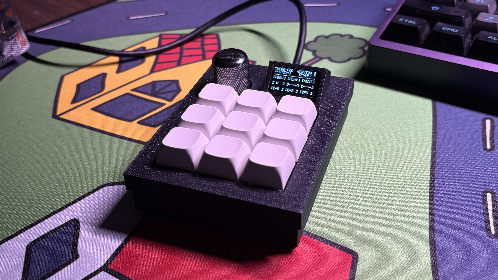

# turbo-pad

Simple 3x3 macropad with an encoder and a cool screen

It supports up to 4 layers and VIA

The firmware is written in QMK

## Flashing

Clone this repo to qmk_firmware/keyboards on your pc and run:

`qmk flash -kb turbo_pad -km via`

## Bootloader

Enter the bootloader in 2 ways:

- **Bootmagic reset**: Hold down the encoder
- **Physical reset button**: Hold down the button on the back of the PCB

---

I will upload all the necessary files to build this project some day
