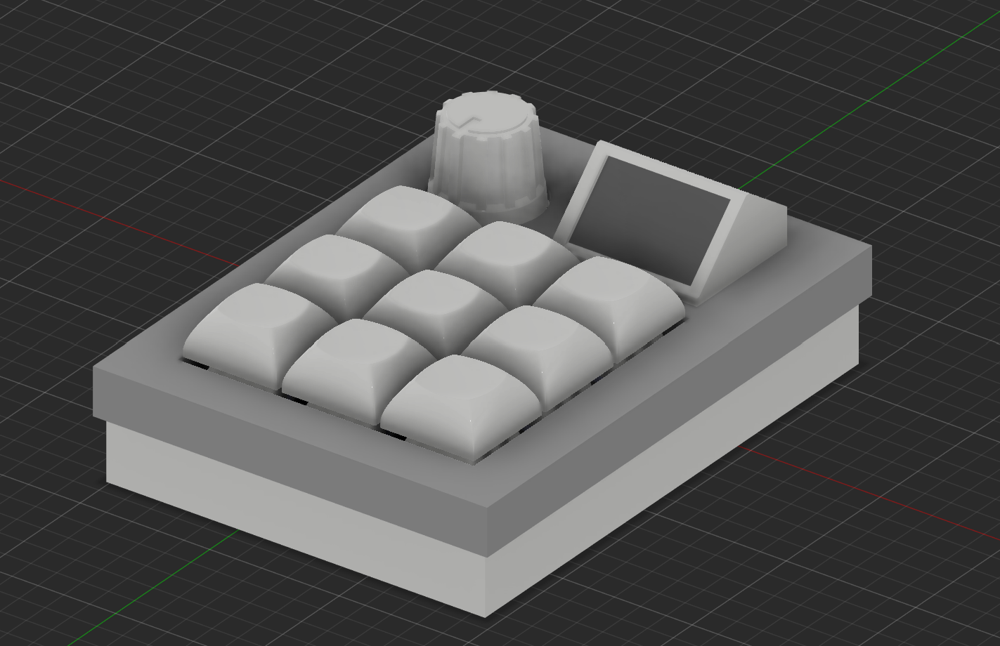

# turbo-pad

Simple 3x3 macropad with an encoder and a cool screen

It supports up to 4 layers and VIA

The firmware is written in QMK

## Flashing

Clone this repo to qmk_firmware/keyboards on your pc and run:

`qmk flash -kb turbo_pad -km via`

## Bootloader

Enter the bootloader in 2 ways:

- **Bootmagic reset**: Hold down the encoder
- **Physical reset button**: Hold down the button on the back of the PCB

## CAD

To build turbopad you will need to 3d print:

- cad/case_bottom.step
- cad/case_top.step
- cad/oled_mount.step
- cad/plate.step

Top case uses 5 M2x3mm heatset inserts (oled pcb uses only 1 screw)

Bottom case uses 6 M2x5mm heatset inserts

To build this project, you will need to unglue oled screen from it's pcb

---

I will upload pcb files and parts list soon
